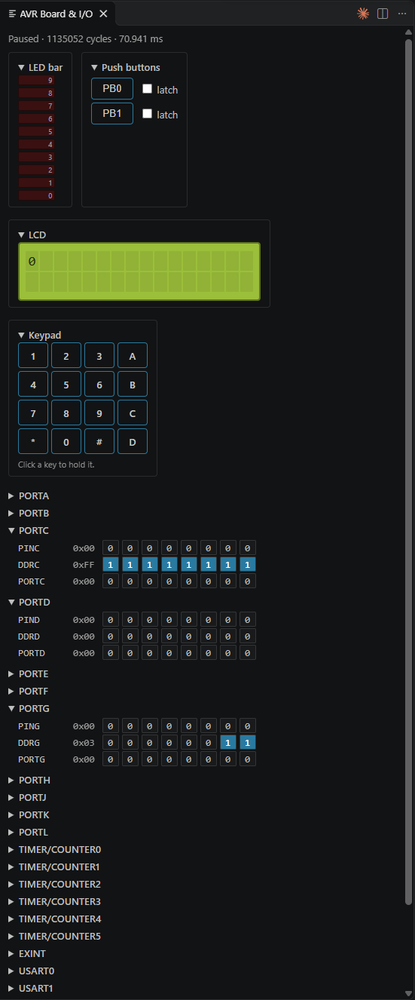
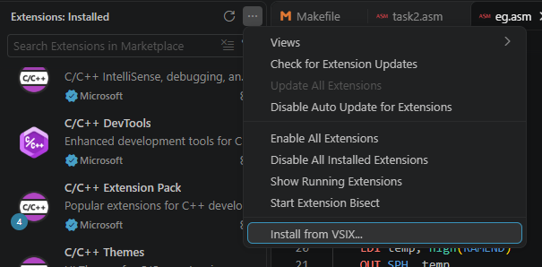

## CS9032 Debugger
A VS Code Extension for Simulating UNSW's CS9032 dev board.

### Installation
1. Download the [latest release](https://github.com/jamiejcole/cs9032-debugger/releases/latest)
2. In VS Code Extensions view, click the more options button (3 dots) and select **"Install from VSIX"**

3. Select the downloaded `.vsix` release
4. Open a .asm file, and click `f5` to start debugging